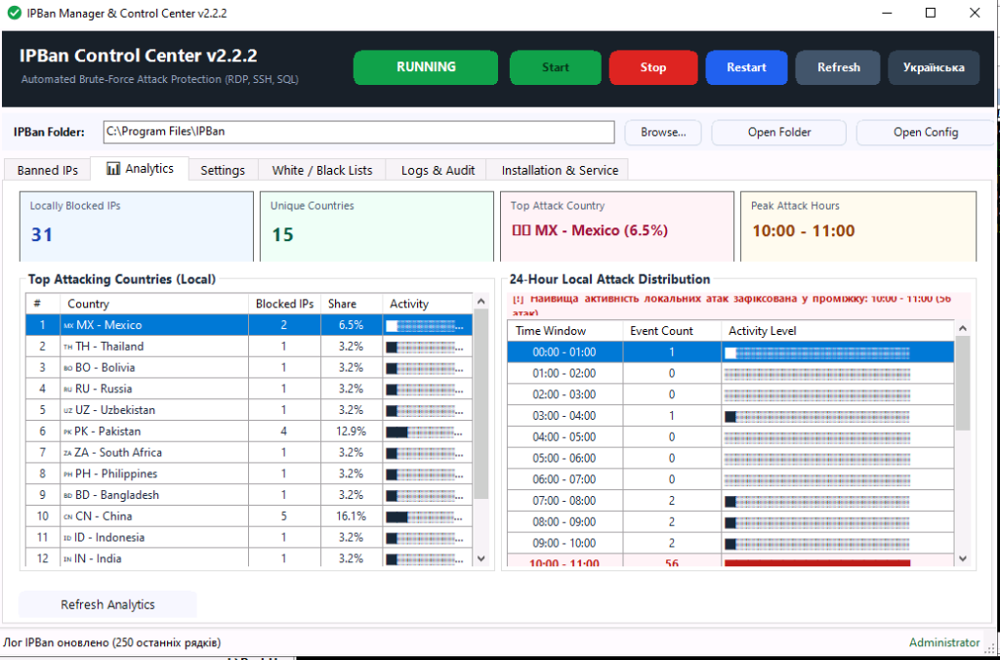

# IPBan Control Center

[](https://microsoft.com)
[](https://github.com/PowerShell/PowerShell)
[](https://github.com/MeXaHiK-7/IPBanGUI/releases/latest)
[](LICENSE)
[](#multi-language-support)

A full-featured, modern Windows graphical user interface (GUI) and management suite for [DigitalRuby IPBan](https://github.com/DigitalRuby/IPBan) security service.

Designed for system administrators, DevOps, and power users running Windows 10, Windows 11, or Windows Server (2012 R2, 2016, 2019, 2022, 2025).

> 🇺🇦 **Українська версія документації**: доступна у файлі [README_IPBan_GUI.md](README_IPBan_GUI.md).

---

<p align="center">
  
</p>

---

## Downloads & Releases

👉 Pre-compiled, standalone single-file executables are available on the [**GitHub Releases**](https://github.com/MeXaHiK-7/IPBanGUI/releases/latest) page:
* **`Setup_IPBanGUI.exe`** — Graphical installer wizard (auto-configures shortcuts, autostart, and security audit).
* **`IPBanControlCenter.exe`** — Portable single-file launcher (no installation required).
* **`IPBanGUI-v2.2.3.zip`** — Complete release archive with executables and documentation.

---

## Key Features

### 📊 Real-Time Attack Analytics & KPI Dashboard
- **4 Live KPI Summary Cards**:
  - Total Locally Blocked IPs.
  - Number of Unique Attacking Countries.
  - Top Attacking Country (% share of total attack volume).
  - Peak Attack Window (hourly range).
- **Top Attacking Countries Leaderboard**: Ranked table with country flag emojis, ban counts, percentage shares, and visual unicode activity bars (`████░░░░`).
- **24-Hour Local Attack Distribution Histogram**: Hourly distribution (00:00 to 23:00) calculated from real local audit events and ban timestamps, highlighting peak attack windows with an alert banner.
- **Isolated Telemetry**: Analytics strictly measure attacks against your local server, unpolluted by external bulk threat lists.

### 🛡️ AbuseIPDB Threat Intelligence Integration
- **Cloud Blacklist Synchronization**: Download up to 10,000 verified malicious IP addresses directly from AbuseIPDB API with configurable confidence threshold (e.g. 90-100%).
- **Isolated Blacklist Architecture**: Downloaded cloud IPs are stored in a dedicated blacklist, keeping the "Locally Blocked IPs" grid clean and focused on direct threats to your server.
- **Optional Auto-Reporting**: Ability to automatically submit local attacker IPs to AbuseIPDB to contribute to global threat intelligence (disabled by default).

### 🔍 Multi-Protocol Service & Port Monitoring
- Visual monitoring and protection for 12 Windows protocols and services:
  - **Remote Access**: RDP (3389), OpenSSH (22), MS VPN RRAS (1723/4500), RD Web Access (443), VNC (5900).
  - **Databases**: MS-SQL Server (1433), MySQL / MariaDB (3306).
  - **Web & File Transfer**: HTTP / Web (80/443), FTP (21).
  - **Mail Services**: SMTP (25/587), IMAP (143/993), POP3 (110/995).
- Live visual status badges (🟢 **Enabled** / ⚪ **Disabled**) with automatic XML expression generation in `ipban.config`.

### 💾 Persistent Cross-Version Configuration Engine
- Machine-wide persistent settings store located in `C:\ProgramData\IPBanControlCenter\settings.json`.
- **Survives upgrades, reinstalls, and uninstalls**: Your AbuseIPDB API key, service monitoring preferences, language, and tray behavior remain intact across version upgrades.
- Real-time auto-saving: Any toggle or input is persisted immediately without requiring manual save clicks.

### 🔔 System Tray Integration & Background Protection
- **Color-Coded Shield Tray Icons**:
  - 🟢 **Green Shield**: Protected & IPBan service running normally.
  - 🔴 **Red Shield**: Service stopped or not installed.
  - 🟠 **Orange Shield + Exclamation**: Real-time alert badge when a new attacker IP is banned.
- **Windows Balloon Notifications**: Native toast popups with attacker IP details upon ban events.
- **Background Minimization**: Closing `[X]` minimizes to the tray to ensure 24/7 background security supervision.

### 🌍 GeoIP Country Detection & Flag Emojis
- Asynchronous GeoIP lookup: Resolves attacker country without freezing or slowing down the UI.
- Local disk caching (`geoip_cache.json`) to minimize network queries.
- Displays flag emojis and country names (e.g., 🇺🇸 US, 🇩🇪 DE, 🇺🇦 UA) in the blocked IPs grid and analytics.
- Automatic recognition of LAN and private IP ranges (`🏠 LAN - Local Network`).

### 🚫 Windows Firewall & Banned IP Management
- Inspect active Windows Firewall rules (`IPBan_*`) with ban time and exact unban countdown.
- Quick filter selector:
  - `⛔ Locally Banned IPs` (direct brute-force attackers)
  - `⚪ Whitelist` (authorized safe IPs)
  - `🏴 Cloud Blacklist` (AbuseIPDB threat intelligence)
  - `📋 All Firewall Rules`
- One-click Whois lookup for any IP via ipinfo.io.
- Instant unbanning of selected IPs or safe reset of local bans.
- Export IP lists to `.txt` or `.csv`.

### ⚙️ Visual Configuration Editor (`ipban.config`)
- Adjust threshold attempts (`FailedLoginAttemptsBeforeBan`), ban duration presets (1 day, 3 days, 1 week, 30 days, permanent), expire time, and cycle intervals.
- Automatic safety backup (`ipban.config.bak`) created prior to saving with one-click restore.

### 📋 Whitelist & Self-Lockout Protection
- Manage trusted subnets and admin workstations.
- **Self-lockout protection buttons**: Automatically detects and whitelists local network adapter IP (`+ Add Local IP`) and public WAN IP (`+ Add Public WAN IP`).

### 📑 Security Event Log & Audit (Event ID 4625)
- Real-time monitoring of failed Windows logons (RDP, Network, SMB, Interactive).
- Details: Timestamp, Username, Source IP, Logon Type, Workstation.
- Instant ban button directly from the event log table.
- Built-in `logfile.txt` viewer with auto-refresh.

### 🔄 Automatic GitHub Update Checker
- Background version checking against GitHub Releases API with notification dialog when updates are available.

### 🌐 Dual Language Support (EN / UA)
- Full Ukrainian and English language support with automatic Windows OS locale detection.
- One-click language switch via the header button.

---

## Installation & Usage

### Option 1: Standalone Installer (Recommended)
1. Download and run **`Setup_IPBanGUI.exe`** from [**Releases**](https://github.com/MeXaHiK-7/IPBanGUI/releases/latest).
2. The installation wizard will guide you through:
   - Selecting the installation folder (default: `C:\Program Files\IPBan Manager`).
   - Desktop and Start Menu shortcut creation.
   - Windows Startup configuration (auto-starts minimized to system tray upon logon).
   - Automated Windows Security Audit policy activation (`AuditPol`).
   - Checking and configuring the IPBan Windows service.
3. Registered in Windows **Add/Remove Programs** with a clean uninstaller that preserves user configuration.

### Option 2: Portable Standalone Launcher
- Download and run **`IPBanControlCenter.exe`** from [**Releases**](https://github.com/MeXaHiK-7/IPBanGUI/releases/latest).
- Requires zero installation; automatically elevates (UAC) and runs anywhere.

---

## Building from Source

To compile the standalone single-file `.exe` binaries with embedded assets:

```powershell
powershell -ExecutionPolicy Bypass -File .\Build_Binaries.ps1
```

This compiles:
1. `app.ico` – Generated multi-layer shield icon.
2. `IPBanControlCenter.exe` – Standalone C# launcher embedding `IPBanGUI.ps1` and `settings.json`.
3. `Setup_IPBanGUI.exe` – Standalone installer embedding the wizard and all dependencies.
4. `release/IPBanGUI-v2.2.3.zip` – Packaged distribution archive.

---

## System Requirements

- **Operating System**: Windows 10, Windows 11, Windows Server 2012 R2 / 2016 / 2019 / 2022 / 2025 (x64)
- **PowerShell**: Version 5.1 or newer (built into Windows 10 / Server 2016+)
- **Privileges**: Local Administrator (required for managing Windows services and firewall rules)

---

## License

This project is licensed under the [MIT License](LICENSE).  
DigitalRuby IPBan is created and maintained by Jeff Johnson / Digital Ruby.
